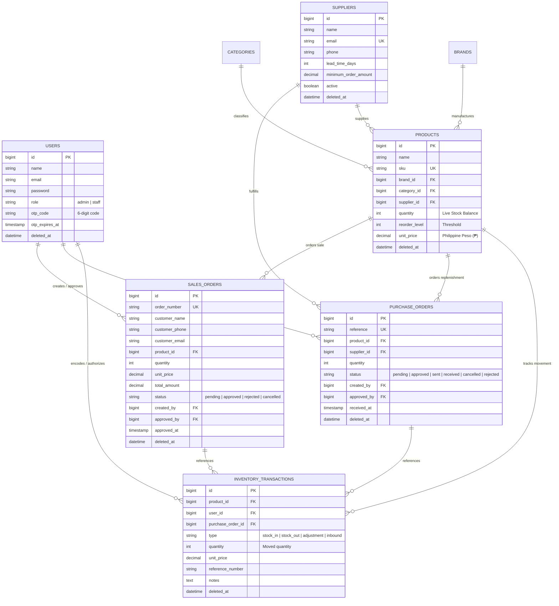
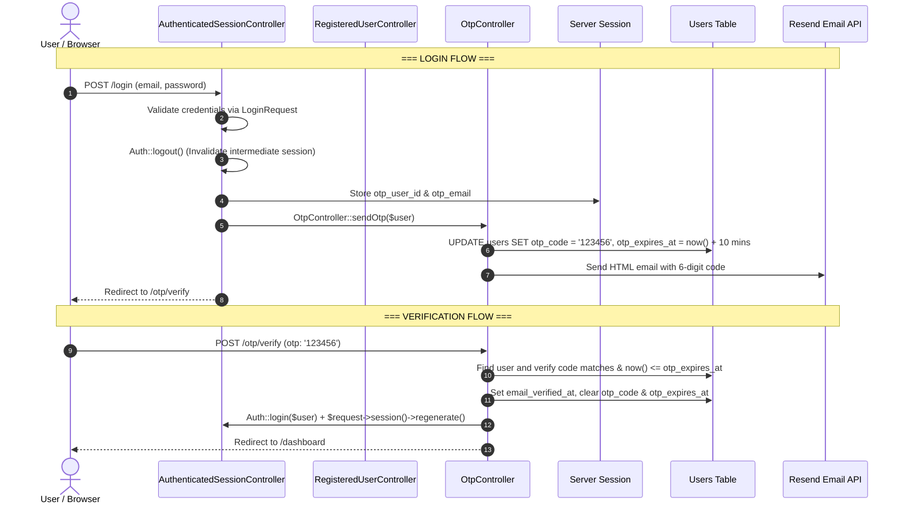
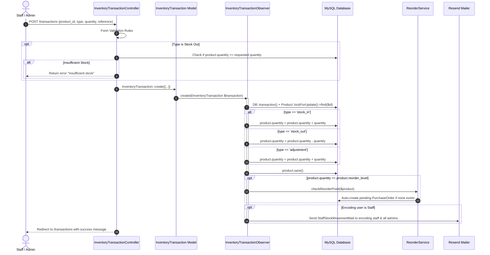
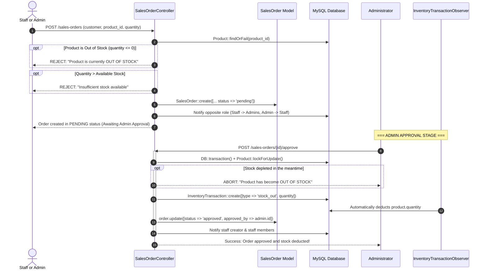

# 🏋️ Gym Inventory Management System — Complete Technical & Architecture Study Guide

> **Project:** Gym Inventory Management System (`lab5_6_7_fitness-tracker_LARAVEL`)  
> **Framework:** Laravel 11 (PHP 8.2+)  
> **Database:** MySQL (InnoDB, utf8mb4)  
> **Frontend:** Blade Templates, Bootstrap 5.3.3, Chart.js 4.4.3, Bootstrap Icons  
> **Email Provider:** Resend API (`resend/resend-laravel`)  
> **Auth:** Laravel Breeze extended with custom Email One-Time Password (OTP) 2FA  
> **Currency Standard:** Philippine Peso (₱ / PHP)

---

## 📑 Table of Contents
1. [System Overview & High-Level Architecture](#1-system-overview--high-level-architecture)
2. [Project Directory & File Structure](#2-project-directory--file-structure)
3. [Database Schema & Entity Relationships](#3-database-schema--entity-relationships)
4. [In-Depth Code Flows & Execution Paths](#4-in-depth-code-flows--execution-paths)
   - [Flow 1: System Boot & Dynamic Setup](#flow-1-system-boot--dynamic-setup)
   - [Flow 2: Email OTP Authentication & Registration](#flow-2-email-otp-authentication--registration)
   - [Flow 3: Stock Movement (Stock In / Stock Out / Adjustment)](#flow-3-stock-movement-stock-in--stock-out--adjustment)
   - [Flow 4: Procurement Lifecycle (Purchase Orders & Bi-Directional Notifications)](#flow-4-procurement-lifecycle-purchase-orders--bi-directional-notifications)
   - [Flow 5: Sales Order Lifecycle (Admin & Staff with Admin Approval & Out-of-Stock Protection)](#flow-5-sales-order-lifecycle-admin--staff-with-admin-approval--out-of-stock-protection)
   - [Flow 6: Audit Trail & Historical Stock Reconciliation](#flow-6-audit-trail--historical-stock-reconciliation)
   - [Flow 7: Real-Time Dashboard & Polling API](#flow-7-real-time-dashboard--polling-api)
   - [Flow 8: Clean Gym Catalog Standards](#flow-8-clean-gym-catalog-standards)
5. [Security, Concurrency & Design Patterns](#5-security-concurrency--design-patterns)
6. [Exam & Viva Study Cheat Sheet (Key Questions & Answers)](#6-exam--viva-study-cheat-sheet)

---

## 1. System Overview & High-Level Architecture

The Gym Inventory Management System is an enterprise-grade stock control, procurement, and dispatch web application tailored strictly for fitness facilities managing gym equipment, accessories, and nutritional supplements.

The system uses an **Event-Driven MVC (Model-View-Controller)** pattern where database mutations are separated from business side-effects through Eloquent Observers, Service classes, and Policy gates.

```
       HTTP Request (Browser / Client)
                     │
                     ▼
             routes/web.php & auth.php
                     │
       ┌─────────────┴─────────────┐
       ▼                           ▼
 Middleware (auth, guest)     Throttle / Security
       │                           │
       └─────────────┬─────────────┘
                     ▼
             Controllers (HTTP handlers)
                     │
         ┌───────────┴───────────┐
         ▼                       ▼
   Service Layer           Eloquent Models
  (ReorderService)      (Product, Transaction, PO, SO)
         │                       │
         │             ┌─────────┴─────────┐
         │             ▼                   ▼
         │      Model Observers       Policy Gates
         │    (Stock Math, Mails)   (Role Permissions)
         │             │                   │
         └─────────────┼───────────────────┘
                       ▼
                 MySQL Database
                       │
         ┌─────────────┴─────────────┐
         ▼                           ▼
    Blade Views                 RESTful JSON
(Glassmorphism UI,           (Real-Time Stats,
 Printable Slips & Invoices)  Chart Endpoints)
```

---

## 2. Project Directory & File Structure

Here is a map of where all key logic resides:

```
lab5_6_7_fitness-tracker_LARAVEL/
├── app/
│   ├── Console/Commands/
│   │   ├── CheckReorderPoints.php        # CLI scheduler command for automated reorders
│   │   └── MakeInventoryAdmin.php        # CLI utility to elevate a user to 'admin'
│   ├── Exports/                          # CSV & PDF export transformers
│   │   ├── ProductsExport.php
│   │   ├── PurchaseOrdersExport.php
│   │   └── InventoryTransactionsExport.php
│   ├── Http/Controllers/
│   │   ├── Api/
│   │   │   └── DashboardApiController.php # JSON endpoints for live polling & charts
│   │   ├── Auth/
│   │   │   ├── AuthenticatedSessionController.php # OTP login initiator
│   │   │   ├── RegisteredUserController.php       # OTP registration initiator
│   │   │   └── OtpController.php                  # 6-digit verification & email dispatcher
│   │   ├── InventoryTransactionController.php     # Audit trail CRUD, manual stock in/out/adj
│   │   ├── ProductController.php                  # Product CRUD, barcode labels, running balances
│   │   ├── PurchaseOrderController.php            # Procurement lifecycle & cross-role notifications
│   │   ├── SalesOrderController.php               # Sales order lifecycle, admin approval & stock guards
│   │   ├── ReportController.php                   # Valuation and stock movement reports
│   │   ├── SupplierController.php                 # Supplier directory & performance calculations
│   │   └── UserController.php                     # Admin user management & role updates
│   ├── Mail/
│   │   ├── LowStockAlert.php                      # Email alert for depleted items
│   │   ├── StaffStockMovementMail.php             # Email alert sent on staff movements
│   │   ├── PurchaseOrderApproved.php
│   │   └── PurchaseOrderCreated.php
│   ├── Models/
│   │   ├── Brand.php                              # Product manufacturer (Rogue, Eleiko, etc.)
│   │   ├── Category.php                           # Product category (Free Weights, Cardio, etc.)
│   │   ├── InventoryTransaction.php               # Live ledger record
│   │   ├── Product.php                            # Item record with status accessors
│   │   ├── PurchaseOrder.php                      # Procurement order
│   │   ├── SalesOrder.php                         # Customer sales order
│   │   ├── Supplier.php                           # Vendor with fulfillment rate helpers
│   │   └── User.php                               # Authenticated staff/admin user
│   ├── Notifications/
│   │   ├── LowStockNotification.php               # Low stock alert
│   │   ├── PurchaseOrderNotification.php          # Bi-directional PO notifications (Staff <-> Admin)
│   │   └── SalesOrderNotification.php             # Bi-directional SO notifications (Staff <-> Admin)
│   ├── Observers/
│   │   ├── InventoryTransactionObserver.php       # Automatic stock update, locks, & email trigger
│   │   └── ProductObserver.php                    # Low-stock notification trigger
│   ├── Policies/                                  # Role-based authorization rules
│   │   ├── ProductPolicy.php
│   │   ├── PurchaseOrderPolicy.php
│   │   ├── SalesOrderPolicy.php
│   │   └── UserPolicy.php
│   ├── Providers/
│   │   └── AppServiceProvider.php                 # Dynamic database creation & policy bindings
│   └── Services/
│       └── ReorderService.php                     # Average daily usage & safety stock algorithms
├── database/
│   ├── migrations/                                # Schema definitions
│   └── seeders/
│       ├── DatabaseSeeder.php                     # Default accounts (admin@gym.com, staff@gym.com)
│       └── ProductSeeder.php                      # 6 authentic gym categories, suppliers, & seed items
├── resources/views/                               # Blade template layer
│   ├── auth/otp.blade.php                         # 6-digit OTP UI
│   ├── dashboard.blade.php                        # Glassmorphism live dashboard with Chart.js
│   ├── products/                                  # Index, show, edit, barcode label views
│   ├── purchase-orders/                           # PO list, detail, and printable PO sheets
│   ├── sales-orders/                              # Sales order list, create, detail, and invoice sheets
│   ├── reports/                                   # Valuation & stock movement tables
│   └── transactions/                              # Audit trail, printable vouchers, & adjustments
├── routes/
│   ├── auth.php                                   # Guest & auth authentication routes
│   └── web.php                                    # Core business routes & API routes
└── start.bat                                      # 1-click startup script for Windows XAMPP
```

---

## 3. Database Schema & Entity Relationships

The data structure is strictly relational, with foreign key integrity, cascade options, and soft-delete support across all tables:



---

## 4. In-Depth Code Flows & Execution Paths

### Flow 1: System Boot & Dynamic Setup

```
[User runs start.bat]
       │
       ▼
[start.bat verifies MySQL connection at 127.0.0.1:3306]
       │
       ▼
[Executes 'php artisan serve']
       │
       ▼
[Laravel Framework Bootstrapping]
       │
       ▼
[AppServiceProvider::boot()]
       ├── Paginator::useBootstrapFive()
       ├── ensureDatabaseExists() -> Connects via raw PDO to create database `inventory_db` if absent
       └── Gate::policy(...) -> Binds all Model Policies (ProductPolicy, PurchaseOrderPolicy, SalesOrderPolicy, UserPolicy)
```

---

### Flow 2: Email OTP Authentication & Registration



---

### Flow 3: Stock Movement (Stock In / Stock Out / Adjustment)



---

### Flow 4: Procurement Lifecycle (Purchase Orders & Bi-Directional Notifications)

Every action made by staff notifies administrators, and every action made by administrators notifies staff:

```
[Staff Action: Created / Cancelled]
            │
            ▼
[PurchaseOrderNotification Triggered]
            │
            ├── Database Notification -> Inserted into `notifications` table for all Admins (Bell Badge)
            └── Email Notification -> Dispatched via Resend/Mail to all Admins

[Admin Action: Approved / Rejected / Sent / Received / Cancelled]
            │
            ▼
[PurchaseOrderNotification Triggered]
            │
            ├── Database Notification -> Inserted into `notifications` table for Staff Creator & all Staff
            └── Email Notification -> Dispatched via Resend/Mail to Staff Creator & all Staff
```

**Actions Matrix & Cross-Role Notification:**
| Action | Performed By | Receivers Notified | Outcome |
|---|---|---|---|
| **Create PO** | Staff | All Administrators | PO created in `pending` status. |
| **Create PO** | Admin | All Staff Members | PO created in `pending` status. |
| **Approve PO** | Admin | Staff Creator + Staff | Status updated to `approved`. |
| **Reject PO** | Admin | Staff Creator + Staff | Status updated to `rejected` with explanation. |
| **Send PO** | Admin | Staff Creator + Staff | Marked as `sent` to supplier. |
| **Receive PO** | Admin | Staff Creator + Staff | Status updated to `received`, stock automatically incremented. |
| **Cancel PO** | Staff / Admin | Opposite Role | Status updated to `cancelled`. |

---

### Flow 5: Sales Order Lifecycle (Admin & Staff with Admin Approval & Out-of-Stock Protection)

Sales orders track member and customer equipment/supplement purchases:



**Core Invariants Enforced:**
1. **Both Admin and Staff can create**: Both roles can record customer orders.
2. **Both require Admin Approval**: Whether created by staff or an administrator, the order initiates as `pending` and must be explicitly approved by an administrator before stock deduction.
3. **Out of Stock Guard**:
   - At creation: If `product.quantity <= 0`, the form is rejected immediately.
   - At approval: Pessimistic locking (`lockForUpdate()`) re-evaluates `product.quantity <= 0` to prevent overselling.

---

### Flow 6: Audit Trail & Historical Stock Reconciliation

- Modifying an audit record's quantity in `InventoryTransactionController::update()` calculates the difference (`$newQty - $oldQty`) and automatically reconciles the product's live stock balance.
- Deleting an audit record (`destroy`) automatically reverses the inventory movement in the observer.

---

### Flow 7: Real-Time Dashboard & Polling API

- **Stat Cards**: Total Products, Low Stock, Out of Stock, Total Inventory Value (₱).
- **Background AJAX Polling**: Every 30 seconds via `/api/dashboard/stats`, `/api/products/low-stock`, and `/notifications/unread`.
- **Chart.js**: Real-time Doughnut, Bar, and Line charts showing distribution and category valuation.

---

### Flow 8: Clean Gym Catalog Standards

All non-gym categories (Lumber, Hardware, Tools, Electrical, Plumbing, Paint) and associated non-gym vendors/brands have been permanently removed.

**Active Gym Categories:**
1. **Free Weights** (Dumbbells, Barbells, Plates, Kettlebells)
2. **Cardio Equipment** (Treadmills, Rowers, Air Bikes)
3. **Strength Machines** (Cable Crossovers, Leg Press, Benches, Smith Machines)
4. **Fitness Accessories** (Yoga Mats, Resistance Bands, Lifting Belts, Chalk)
5. **Supplements & Nutrition** (Whey Protein, Creatine, Pre-Workout)
6. **Recovery & Mobility** (Massage Guns, Foam Rollers, Mobility Floss)

---

## 5. Security, Concurrency & Design Patterns

1. **Role-Based Access Control (RBAC)**: Model policies govern all operations (`SalesOrderPolicy`, `PurchaseOrderPolicy`, `ProductPolicy`, `UserPolicy`).
2. **Pessimistic Concurrency**: `Product::lockForUpdate()` is applied to prevent race conditions during concurrent stock operations.
3. **Self-Deletion Protection**: Administrators cannot delete their own account or delete the sole remaining administrator.
4. **Soft Deletes**: Enabled across all models (`Product`, `Supplier`, `PurchaseOrder`, `SalesOrder`, `InventoryTransaction`, `User`).

---

## 6. Exam & Viva Study Cheat Sheet

### Q1: How is the cross-role notification requirement implemented for Purchase Orders?
> **Answer:** In `PurchaseOrderController`, a centralized `notifyPurchaseOrderParties()` method checks the actor's role. If staff performs an action (create, cancel), all administrators are fetched and notified. If an administrator performs an action (approve, reject, send, receive, cancel), all staff members (including the order creator) are notified. Notifications are saved to the database (powering the navbar bell icon) and sent as transactional emails.

### Q2: Why do Sales Orders created by administrators also require approval?
> **Answer:** Per strict dual-control inventory governance, all sales orders are initially staged in `pending` status. This prevents unverified order slips from immediately deducting physical stock and allows a distinct verification/approval audit trail (`approved_by`, `approved_at`).

### Q3: How is the "out of stock" protection enforced for Sales Orders?
> **Answer:** At two distinct levels:
> 1. **At Order Entry**: `SalesOrderController::store()` checks if `$product->quantity <= 0` or if `$request->quantity > $product->quantity`. If out of stock, it halts and returns a validation error.
> 2. **At Approval**: `SalesOrderController::approve()` uses a database transaction with `Product::lockForUpdate()`. It re-evaluates the live stock before deducting to protect against race conditions where another transaction depleted the item in the interim.

### Q4: What happens to inventory when a Sales Order is approved?
> **Answer:** `SalesOrderController::approve()` creates an `InventoryTransaction` of type `stock_out` referencing the sales order number. The `InventoryTransactionObserver` detects the `stock_out` event, decrements `$product->quantity`, checks if it has dropped below the reorder point, and updates the live stock balance.
